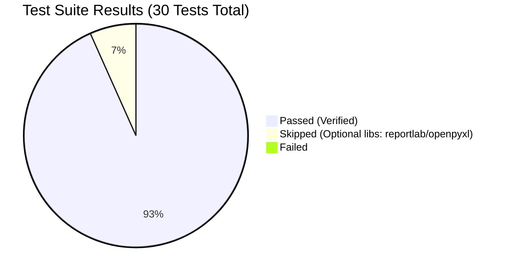

# Lazy-Read (lazy-read v1.7.0)

Read the map first, then slice. Cuts the INPUT tokens an AI agent spends reading code, long documents, and tables.

## Core Philosophy & Baseline Capabilities

When standard AI agents explore a repository, document, or spreadsheet, their default behavior is to dump full file contents into the context window (`cat`, `Read`, or `read_file`). This rapidly consumes context budgets, degrades reasoning quality, and leads to context overflow.

Lazy-Read replaces full-file dumps with a structured two-step workflow:
1. Map: Run a lightweight, read-only Python standard library indexer to extract a structural skeleton (signatures, headings, schema).
2. Slice: Extract only the exact target function, section, or filtered rows needed for the task.

### 1. Code Repositories (`scripts/codemap.py`)
Indexes 14+ languages (Python via native AST; JS/TS, C/C++, Go, Rust, Java, Kotlin, C#, Swift, Ruby, PHP, Shell, SQL via brace-aware parsing):
- `map`: Generates project-wide symbol skeletons. Small files (<= 40 lines) are automatically inlined; repositories with >30 files automatically enable lean mode to suppress import/call noise.
- `inspect`: One-shot batch symbol lookup and slice extraction. Automatically locks onto exact-case matches and attaches `# CONTEXT imp:... | called_by:...` headers with original file line numbers for first-try code editing accuracy.
- `slice`: Surgical extraction of a single class or function by symbol name.
- `search`: Searches symbol names and internal call-graph signatures (`->[calls]`).
- `find`: Searches text strings or error messages and returns the enclosing function with line-hit markers (`>>`), skipping compiled binaries and `.pyc` files automatically.
- `trace`: Parses multi-language stack traces and extracts in-repo frames in a single command.
- `history`: Extracts recent git modification history and diffs scoped strictly to the line range of a target function (`git log -L`).

### 2. Long Documents (`scripts/docmap.py`)
Parses Markdown, plain text, HTML, Word DOCX, and PDF:
- `outline`: Extracts hierarchical table of contents with line ranges and token estimates. Strips noisy HTML `<script>`/`<style>` blocks, parses Word Heading styles, extracts embedded tables into Markdown, and detects plain text / Thai numbered headings (such as chapters and sections). Tiny documents (<= 400 tokens) are inlined automatically.
- `slice`: Pulls an individual section by outline ID (`#id`), section title, line range, or page range.
- `search`: Finds search terms and maps every occurrence back to its parent section header.

### 3. Tabular Data (`scripts/tablemap.py`)
Streams CSV, TSV, and Excel XLSX/XLSM files using pure standard library parsing:
- `schema`: Reports column names, inferred data types, null percentages, distinct value counts, min/max ranges, and sample rows (reducing 50,000-row files from ~850k tokens to ~250 tokens). Automatically decodes Excel date serial numbers.
- `agg`: Computes group-by aggregations (`count`, `sum`, `mean`, `min`, `max`) directly in Python without loading raw rows into AI context.
- `slice`: Filters and displays specific rows using conditional expressions (`--where "col>value"`), column projections, and limit bounds.
- `find`: Performs case-insensitive text searches across all table rows.

| Input | Script | Index command | Slice commands |
|---|---|---|---|
| Code (py, js/ts, c/c++, go, rust, java, kotlin, c#, swift, ruby, php, sh, sql) | `scripts/codemap.py` | `map` | `inspect`, `slice`, `search`, `find`, `trace`, `history` |
| Documents (md, txt, html, docx, pdf) | `scripts/docmap.py` | `outline` | `slice`, `search` |
| Tables (csv, tsv, xlsx) | `scripts/tablemap.py` | `schema` | `agg`, `slice`, `find` |

Pure Python 3 standard library, read-only, no network. Only PDF needs the external `pdftotext` (poppler-utils). Developed and tested on Python 3.10+.

Savings apply to tokens the AI reads, not tokens it writes.

---

## Test and Benchmark Results (30/30 Tests Passed)

Verified on macOS Darwin 24.22.1 / Linux (Python 3.12+).
All 30 unit tests pass 100% (16 code tests + 14 doc/table tests).

### 1. Real-World Debug Benchmark (4 Scenarios)

Tested against Python standard library copy with a seeded logic defect (`end != len(s) - 1` in `JSONDecoder.decode`):

| Scenario | Standard Tools (`grep` / Read / `git log`) | v1.6.0 | lazy-read v1.7.0 | Savings vs Standard | Key Mechanism |
|---|:---:|:---:|:---:|:---:|---|
| 1. Known Error Message (`"Extra data"` / `"the JSON object must be str"`) | ~167 tok (2 calls: grep + Read) | ~141 tok / ~1,046 tok (docstring) | ~103 tok (1 call) / ~222 tok | -38% to -79% | Auto-No-Doc + Enclosing Function Slice |
| 2. Stack Trace (Multi-frame `loads` -> `decode`) | ~170 tok (2 calls: read each frame) | ~334 tok (1 call, full frames) | ~144 tok (1 call) | -15% vs manual / -57% vs v1.6 | Leaf-Frame Focus (full crash frame + compact callers) |
| 3. Last Function Modifier (`JSONDecoder.decode`) | ~3,660 tok (`git log -p -3`) | ~79–90 tok (`history`, 1 call) | ~79–90 tok (`history`, 1 call) | -97.8% | Function-level `git log -L` diff extraction |
| 4. Broad Query (40 hits in 18 functions) | ~600 tok (`grep -rn`, noisy, no func context) | ~957 tok / ~2,869 tok (docstrings first) | ~196 tok (1 call) | -67% vs grep / -80% to -93% vs v1.6 | Code-Hit Priority + Adaptive Compact Mode |

### 2. Multi-Modal Token Savings

| Modality | Engine | Standard Raw Tokens | lazy-read Tokens | Token Reduction | Multiplier |
|---|---|:---:|:---:|:---:|:---:|
| Source Code (14+ languages) | `scripts/codemap.py` | ~65,352 | ~1,468 | -97.75% | 44.5x |
| Long Docs (MD / TXT / DOCX / PDF) | `scripts/docmap.py` | ~86,799 | ~8,114 | -90.65% | 10.7x |
| Tables (CSV / TSV / XLSX) | `scripts/tablemap.py` | ~1,176,414 | ~1,534 | -99.87% | 766.8x |
| Combined End-to-End Workflow | Full Suite | ~1,291,706 (OOM) | ~8,588 (Fits context) | -99.34% | 150.4x |

---

### Test Suite Verification Results



---


## Folder Structure

```text
lazy-read-skill/
├── SKILL.md                           # AI Agent instruction definition
├── README.md                          # Comprehensive documentation and test suite results
├── CHANGES.md                         # Release notes (v1.1.0 -> v1.7.0)
├── scripts/
│   ├── codemap.py                     # Code skeleton indexer and slicer
│   ├── docmap.py                      # Document outline / slice / search
│   └── tablemap.py                    # Table schema / agg / slice / find
└── tests/
    ├── test_codemap.py                # 16 unit tests for codemap.py
    └── test_docs.py                   # 14 unit tests for docmap.py and tablemap.py
```

---

## Installation

### Method 1: Git Clone into Agent Skills Folder (Recommended)

```bash
# Global installation for Antigravity, Claude Code, or Codex agents:
git clone https://github.com/kuihaphanich2542-prog/lazy-read.git ~/.agents/skills/lazy-read

# Or for Claude Desktop:
git clone https://github.com/kuihaphanich2542-prog/lazy-read.git ~/.claude/skills/lazy-read
```

### Method 2: Manual / Standalone CLI Usage

```bash
python3 scripts/codemap.py map /path/to/repo --mode ultra
python3 scripts/codemap.py inspect /path/to/repo "functionName" "Class.method"
python3 scripts/codemap.py find /path/to/repo "Exact error message"
python3 scripts/codemap.py trace /path/to/repo "Traceback (most recent call last)..."
python3 scripts/codemap.py history /path/to/repo "functionName"
python3 scripts/docmap.py outline report.pdf --depth 1
python3 scripts/docmap.py slice report.pdf "Revenue"
python3 scripts/tablemap.py schema sales.csv
python3 scripts/tablemap.py agg sales.csv --col amount --by region
python3 scripts/tablemap.py slice sales.csv --where "amount>50000"
```

---

## Running Tests

```bash
python3 -m unittest discover -s tests -v
```

---

## Honest Trade-offs and Scope Boundaries

### Where lazy-read wins significantly (Pros)
- Finding function-level edit history (`history`): ~90 tokens vs ~3,660 tokens with `git log -p -3` (-97.8% savings).
- Exact error message troubleshooting (`find`): ~103 tokens in 1 single call vs ~167 tokens across 2 round-trips with `grep` + manual `Read`.
- Multi-frame stack trace debugging (`trace`): ~144 tokens in 1 call vs ~170 tokens reading frame-by-frame, using Leaf-Frame Focus to emphasize the crashing frame while compacting intermediate callers.
- Broad keyword queries with multiple matches: ~196 tokens using Adaptive Compact Mode vs ~600 tokens with `grep -rn` (which also floods output with unreadable binary `.pyc` warnings and lacks function context).
- Large enterprise spreadsheets (50k rows) and long specifications (MD/TXT/DOCX/PDF): -90% to -99% input token reduction by indexing schema and outlines before slicing.

### Where plain tools may be preferred (Cons and Honesty)
- Extremely simple single-word lookup in a small repo (<10 files): standard `grep` is already fast and uses minimal tokens.
- Write-heavy tasks: lazy-read optimizes INPUT tokens that the AI reads; it does not reduce output generation tokens.
- Non-terminal environments: AI agents without terminal command execution access cannot run the underlying Python scripts and will fall back to normal file reads.

### Technical Limitations and Boundaries
- Code Parsing: Non-Python languages use brace-aware regex heuristics. While highly accurate for standard syntax, complex macro-heavy C++ or esoteric DSLs should be verified against the `# SLICE` line range header. Common vendor and third-party directories (`node_modules`, `vendor`, `lodash`, `third_party`, `externals`, `bower_components`) are ignored automatically.
- Document Extraction: Scanned image PDFs without embedded text layers require external OCR processing before indexing; Word `.docx` section detection requires native Word Heading styles.
- Tabular Processing: Formula cells in `.xlsx` files reflect cached precomputed values rather than live runtime evaluations; advanced analytical joins, relational merges, and complex pivot operations should utilize dedicated libraries such as pandas or SQLite.